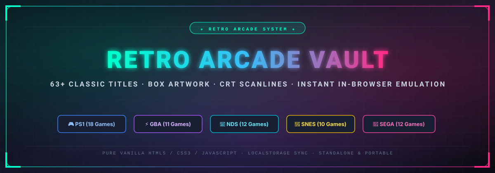

<p align="center">
  
</p>

<p align="center">
  <a href="https://lin4cre.github.io/retro-arcade-vault/"></a>
  <a href="#-dual-hall-arcade-architecture"></a>
  <a href="#-curated-game-library-126-titles"></a>
  <a href="#-automated-test-verification"></a>
  <a href="#license"></a>
  
</p>

---

## 📖 Overview

**Retro Arcade Vault** is an ultra-fast, zero-dependency retro gaming web application designed for instant, offline-capable browser play. Built on a modular **Dual-Hall Architecture**, the vault pairs standalone 60 FPS HTML5 Canvas arcade games with a curated 126-title retro emulation library across PlayStation 1, Game Boy Advance, Nintendo DS, Super Nintendo, and Sega Genesis.

Zero build pipelines. Zero external runtime dependencies. 100% self-contained vanilla HTML5, CSS3 Shaders, and Web Audio API synthesis.

👉 **Play Live**: **[https://lin4cre.github.io/retro-arcade-vault/](https://lin4cre.github.io/retro-arcade-vault/)**

---

## 🏛️ Dual-Hall Arcade Architecture

Retro Arcade Vault features a **Dual-Hall Navigation System** that allows seamless switching between two distinct gaming paradigms:

```
┌────────────────────────────────────────────────────────────────────────┐
│                        RETRO ARCADE VAULT                              │
├───────────────────────────────────┬────────────────────────────────────┤
│   🕹️ NATIVE ARCADE CLASSICS        │   💾 CURATED EMULATION VAULT       │
│   • 100% Offline & Zero Lag       │   • 126 Curated Retro Classics     │
│   • HTML5 Canvas 60 FPS Engine    │   • PS1, GBA, NDS, SNES, Sega      │
│   • Procedural Web Audio Synth    │   • Fixed Metadata & Local Covers  │
│   • Automated High Score Top 10   │   • Graceful Legal / 451 Fallbacks │
│   • Snake, Pong, Breakout, etc.   │   • Manuals, Lore & Custom Notes   │
└───────────────────────────────────┴────────────────────────────────────┘
```

1. **🕹️ Hall 1: Native Arcade Classics (Canvas 60 FPS Engine)**
   - Standalone, offline-capable canvas stage (`<canvas id="arcadeCanvas">`) running at 60 FPS with fixed-timestep physics.
   - Built-in classic retro arcade games (*Neon Snake*, *Cyber Pong*, *Brick Smasher*, *Space Invaders*, *Asteroids Odyssey*).
   - Zero external emulator network requests; immediate gameplay with keyboard, gamepad, and touch controls.
   - Automated Hall of Fame score submission with 3-letter arcade initials and top-10 ranking.

2. **💾 Hall 2: Curated Emulation Vault (126 Titles)**
   - Curated catalog spanning five golden eras of console gaming.
   - Repaired metadata with all 21 Sega Genesis titles accurately unified under the `SEGA` category.
   - 15 local vector SVG box arts stored in `assets/covers/` resolving previous remote 404 image failures.
   - Dedicated **HTTP 451 Status Notice Overlay** for external WebAssembly titles (Call of Duty: Black Ops Zombies) providing direct standalone window launching.

---

## ⚙️ Core Subsystems

### 💾 Centralized Storage Engine (`src/core/storage.js` — Schema v4.0)
- **Unified Document Schema**: All state (high scores, achievements, playtime statistics, display settings, keybindings, favorites, recents, and notes) is persisted atomically under `retro_vault_v4`.
- **Automated High Score Hall of Fame**: Maintains the exact top 10 scores per game, enforces 3-letter uppercase alphanumeric initials (`[A-Z0-9]{3}`), and breaks ties by timestamp.
- **In-Memory Fallback Driver (`MemoryStorageDriver`)**: Transparently takes over if `localStorage` is blocked in private browsing, sandbox iframes, or when storage quotas are exceeded.
- **Multi-Version Migration**: Automatically scans, upgrades, and normalizes legacy data from v1, v2.1, and v3 schemas.
- **Symmetrical Backup & Restore**: Full JSON roundtrip export and import with structural validation and idempotent XSS sanitization (remediating legacy silent data loss where high scores and trophies were dropped).

### 🔊 Procedural Web Audio Synthesizer (`src/core/audio.js`)
- **3-Stage Gain Hierarchy**: Independent SFX Gain and BGM Gain routed through a Master Gain node to `audioCtx.destination`, supporting fine-grained volume sliders (0–100%) and mute toggling.
- **Pure Procedural Waveforms**: Synthesizes square, triangle, sawtooth, and sine tones on-the-fly without static audio assets.
- **Cached White Noise Buffer**: Pre-generates a 1.0-second mono noise buffer (44.1 kHz) for explosive percussions, snare hits, and rocket thrusts without garbage collection spikes.
- **Procedural Chiptune Radio**: Background arpeggiator radio with 3 station presets (*Synthwave*, *8-Bit Quest*, *Cyberpunk Arp*), safe interval scheduling, and automatic node disposal preventing memory leaks.
- **Autoplay Resilience & Headless Safety**: One-time passive interaction listeners unlock suspended contexts; headless Node.js environments safely no-op without runtime errors.

### 🎨 Local Vector SVG Box Art Generator (`scripts/generate-covers.js`)
- Generates 15 authentic, vector-drawn SVG box arts in `assets/covers/` for offline reliability, replacing broken remote third-party URLs.

---

## 🛠️ Audited Defect Remediation Summary

Milestone 1 addresses and resolves ten critical architectural and UX defects identified in the legacy codebase:

| # | Audited Defect | Root Cause | Remediated Behavior |
|---|---|---|---|
| 1 | **Dead Session Stopwatch** | `startSessionTimer()` declared but had 0 invocations. | Called on `selectGame(id)`; updates LED stopwatch and accumulates `playTimes`. |
| 2 | **Dead Passive Trophies** | `checkPassiveTrophies()` had 0 call sites. | Invoked on `selectGame()`, `toggleStar()`, category filter clicks, and startup. |
| 3 | **Unincremented Play Stats** | `playStats[id]` never incremented on game launch. | Increments on game launch, updates `🎮 X` badges, and enables "Most Played" sort. |
| 4 | **Unreachable "Coin Drop"** | `unlockTrophy("COIN_DROP")` had 0 call sites. | Automatically awarded upon first game launch. |
| 5 | **Sega Genesis Category Discrepancy** | 3 Sega games tagged `"GENESIS"` instead of `"SEGA"`. | Normalized to `"SEGA"`; filter badge accurately displays all 21 titles. |
| 6 | **Trophy Badge /12 Overwrite** | `trophyBadgeCount` hardcoded string `count + "/12"`. | Dynamically computes `count + "/" + TROPHIES_CATALOG.length` (X/17). |
| 7 | **Broken Cover Art URLs** | 15 titles pointed to non-existent remote PNGs (HTTP 404). | Replaced with local vector SVGs generated in `assets/covers/`. |
| 8 | **COD Zombies Iframe Denial** | `vel.gg/bo1z` returns HTTP 451 with `X-Frame-Options`. | Displays dedicated status notice overlay with direct standalone window launcher. |
| 9 | **Default Game Deletion Illusion** | `loadGames()` unconditionally re-merged all defaults. | `deletedDefaultIds` Set persisted in localStorage prevents resurrection. |
| 10 | **Silent Backup Data Loss** | Variable mismatch (`customNotes` vs `userNotes`) & missing import keys. | Symmetrical export/import preserves 100% of state (scores, trophies, notes, times). |

---

## 🧟 ⭐ Featured Showcase: Call of Duty: Black Ops Zombies

Powered by high-performance WebAssembly, experience the authentic **Black Ops Zombies** experience with 10 legendary maps:

- 🎭 **Kino der Toten** — Battle through the Berlin theater, link the teleporter, and trigger the secret song *"115"*.
- 🏛️ **"Five"** — Defend the Pentagon as JFK, Nixon, Castro, and McNamara against the Thief and DEFCON panic.
- 🏭 **Der Riese** — The birthplace of Pack-a-Punch and Nazi undead experiments.
- 🏚️ **Nacht der Untoten** — The original airfield bunker holdout.
- 🏥 **Verrückt** — The asylum where squads spawn separated on opposite sides.
- 🌿 **Shi No Numa** — The treacherous Imperial swamp outpost with the Flogger trap.
- 🚀 **Ascension** — The Soviet cosmodrome featuring lunar landers, space monkeys, and PhD Flopper.
- 🚢 **Call of the Dead** — Siberian lighthouse, shipwreck, and George A. Romero on the prowl.
- 🌴 **Shangri-La** — Jungle temple with geysers, minecarts, and the 31-79 JGb215 Shrink Ray.
- 🌕 **Moon** — From Area 51 to the low-gravity lunar base with the Wave Gun and Gersh devices.

### 🎮 Black Ops Zombies Controls
| Action | Keyboard / Mouse Control |
| :--- | :---: |
| **Move** | <kbd>W</kbd> <kbd>A</kbd> <kbd>S</kbd> <kbd>D</kbd> |
| **Aim / Look** | **Mouse Look** (Click game canvas to lock cursor) |
| **Fire Weapon** | **Left Mouse Click** |
| **Aim Down Sights (ADS)** | **Right Mouse Click** |
| **Jump / Mantle** | <kbd>Space</kbd> |
| **Sprint** | <kbd>Left Shift</kbd> |
| **Crouch / Prone** | <kbd>C</kbd> (Crouch) / <kbd>Ctrl</kbd> (Prone) |
| **Reload** | <kbd>R</kbd> |
| **Interact / Buy Weapon / Open Door** | <kbd>F</kbd> |
| **Melee / Knife** | <kbd>V</kbd> |
| **Frag Grenade** | <kbd>G</kbd> / Middle Mouse |
| **Switch Weapon** | <kbd>1</kbd> / <kbd>2</kbd> / Scroll Wheel |
| **Release Mouse Pointer Lock** | <kbd>Esc</kbd> |

---

## 🕹️ Controls Reference Guide

Click the **🕹️ CONTROLS** button on the top bar at any time to inspect mappings and test your controller:

### Keyboard Mappings (RetroGames.cc Default)
| Action / Button | RetroGames Keyboard Key | Gamepad (Standard Layout) |
| :--- | :---: | :---: |
| **D-Pad Up / Down / Left / Right** | <kbd>↑</kbd> <kbd>↓</kbd> <kbd>←</kbd> <kbd>→</kbd> Arrow Keys | D-Pad / Left Analog Stick |
| **A / Cross (✕) / Confirm** | <kbd>X</kbd> | Bottom Face Button (<kbd>A</kbd> / <kbd>✕</kbd>) |
| **B / Circle (○) / Cancel** | <kbd>Z</kbd> | Right Face Button (<kbd>B</kbd> / <kbd>○</kbd>) |
| **X / Square (□)** | <kbd>S</kbd> | Left Face Button (<kbd>X</kbd> / <kbd>□</kbd>) |
| **Y / Triangle (△)** | <kbd>A</kbd> | Top Face Button (<kbd>Y</kbd> / <kbd>△</kbd>) |
| **Left Shoulder (L1 / L)** | <kbd>Q</kbd> | Left Bumper / Trigger (<kbd>LB</kbd> / <kbd>L1</kbd>) |
| **Right Shoulder (R1 / R)** | <kbd>W</kbd> | Right Bumper / Trigger (<kbd>RB</kbd> / <kbd>R1</kbd>) |
| **Select / Back** | <kbd>Shift</kbd> | Back / View / Share |
| **Start / Pause** | <kbd>Enter</kbd> | Start / Menu / Options |

---

## 🧪 Automated Test Verification

Retro Arcade Vault features a **zero-external-dependency automated test runner** built on Node.js native `node:test` and `node:assert/strict`.

### Running All Automated Tests
```bash
npm test
```
*Equivalent command*:
```bash
node --test tests/*.test.js
```

### Running Specific Subsystem Suites
```bash
# Verify StorageService Schema v4.0 & In-Memory Fallback
node --test tests/storage.test.js

# Verify Web Audio Synthesizer & Procedural Sound Clamps
node --test tests/audio.test.js

# Verify DOM Layout, Dual-Hall Navigation & Modals
node --test tests/dom.test.js

# Verify Milestone 1 Defect Remediations & SVG Cover Arts
node --test tests/m1-integrity.test.js
```

---

## 🚀 Getting Started

### Play Locally in Browser
Simply open `index.html` directly in any modern web browser (Chrome, Edge, Firefox, Brave, Safari). No web server, compilation, or npm installation needed!

### Host with GitHub Pages
1. Fork or clone this repository:
   ```bash
   git clone https://github.com/LIN4CRE/retro-arcade-vault.git
   ```
2. In GitHub repository settings, go to **Pages** -> Source: **Deploy from a branch** -> Branch: `main` / `/root`.
3. Your arcade is live in 60 seconds!

---

## ⚖️ License
This project is open-source under the [MIT License](LICENSE).
